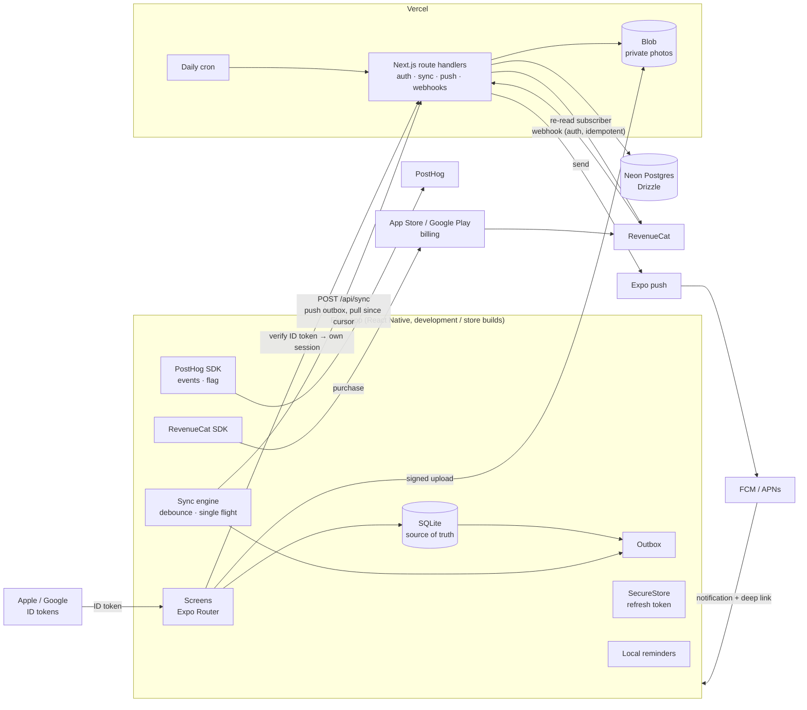

# PlantPal

A plant-watering app (Expo / React Native, with a Next.js API) built as a portfolio project to prove
mobile engineering end to end: store release, social sign-in, offline-first sync, push
notifications, in-app subscriptions, release engineering, testing and analytics.

> **Built with AI assistance.** This project was built with Claude Code as a pair programmer.
> I (Samil Abud) reviewed every change and can explain every file
> ([interview notes](docs/INTERVIEW_NOTES.md)).
> Premium is a real Google Play in-app purchase (USD 0.50 / month, 5 / year, 10 lifetime), priced
> low on purpose. Every purchase so far was a **test purchase**: no revenue is claimed.

**Status:** **Live on Google Play** since 2026-10-19:
[play.google.com/store/apps/details?id=com.samilabud.plantpal](https://play.google.com/store/apps/details?id=com.samilabud.plantpal).
iOS is **not yet on TestFlight** (Apple developer account pending). See the [final report](docs/FINAL_REPORT.md) for what is and
isn't proven.

## What it does
Sign in with Google (Apple on iOS), add plants with a photo and a watering interval, and tap
**Water**. The list shows what's due; reminders arrive the morning a plant needs water; everything
works offline and syncs across devices. Not sure what the plant is? **Identify with AI** suggests
its name and watering interval from a photo, and you confirm before saving. The app is in
**English and Spanish**. Premium unlocks unlimited plants, photo history and more AI
identifications. Account deletion lives in Settings.

## Architecture



| Path | What's there |
|---|---|
| `apps/mobile` | Expo SDK 57 app: Expo Router, TypeScript strict, development build, expo-sqlite, Zustand + React Query |
| `apps/api` | Next.js 16 route handlers, Drizzle + Postgres (Neon in production), Vercel Blob and Cron |
| `packages/shared` | Zod schemas shared by the app and the API (the API contract) |
| `docs/` | [plan](docs/M0_PLAN.md), [evidence](docs/evidence/), [release](docs/release/), [interview notes](docs/INTERVIEW_NOTES.md), [final report](docs/FINAL_REPORT.md) |

## Claims and evidence
Each claim links to the evidence that proves it. ✅ proven · 🟡 partly proven · ❌ not proven.

| Claim | Evidence | Status |
|---|---|---|
| Android app **published on Google Play** (production, passed Google's review), first tested through internal testing on a real phone | [M7](docs/evidence/m7-release.md#google-play-internal-testing-real-phone-production-server), [store page](https://play.google.com/store/apps/details?id=com.samilabud.plantpal) | ✅ |
| iOS app on **TestFlight / App Store** | [checklist](docs/release/RELEASE_CHECKLIST.md) | ❌ Apple account pending |
| **Sign in with Google**, verified on the server, against production | [M2](docs/evidence/m2-auth.md), [M7](docs/evidence/m7-release.md#google-sign-in-android) | ✅ |
| **Sign in with Apple** (nonce, token verification, grant revocation on deletion) | [M2](docs/evidence/m2-auth.md) | 🟡 implemented and tested on the server; not run on an iPhone |
| Own sessions: short access token, rotating refresh token with reuse detection, SecureStore | [M2](docs/evidence/m2-auth.md) | ✅ |
| **Account deletion** in the app and on the web (data, photos, RevenueCat customer) | [M2](docs/evidence/m2-auth.md), [M7](docs/evidence/m7-release.md#privacy-support-and-deletion-pages-live) | ✅ |
| **Offline-first**: SQLite source of truth, outbox, sync endpoint, last-write-wins with clock clamp, tombstones | [M3](docs/evidence/m3-offline-sync.md) | ✅ |
| Camera / photo library, compression, private upload with signed URLs | [M3](docs/evidence/m3-offline-sync.md) | ✅ |
| **Push**: permission flow, local reminders, remote push (Expo → FCM), deep link from a notification | [M4](docs/evidence/m4-notifications.md) | ✅ Android (dev build and the Play build) · ❌ iOS device |
| **Subscriptions** with RevenueCat: paywall, entitlement on device and server, signed idempotent webhook, replay test, restore | [M5](docs/evidence/m5-subscriptions.md) | ✅ |
| Real Google Play sandbox purchase → renewals → expiry, all reaching the server | [M7](docs/evidence/m7-release.md#google-play-internal-testing-real-phone-production-server) | ✅ |
| Development build and config plugins (not Expo Go) | [M1](docs/evidence/m1-foundation.md) | ✅ |
| **EAS Build**, versions, channels, environment variables | [M7](docs/evidence/m7-release.md) | ✅ Android |
| **EAS Update** (OTA) on a staging channel, received by an installed build | [M7](docs/evidence/m7-release.md#eas-update-on-the-staging-channel) | ✅ |
| **EAS Submit** to Google Play | [M8](docs/evidence/m8-portfolio.md#eas-submit-gap-7) | ✅ |
| **CI**: secret scan, lint, typecheck, tests with coverage report; manual EAS build workflow | [M6](docs/evidence/m6-quality.md#ci) | ✅ |
| Unit, component and integration tests (Jest with the React Compiler on, React Native Testing Library, Vitest with real Postgres) | [M6](docs/evidence/m6-quality.md), [M8](docs/evidence/m8-portfolio.md#fresh-clone-definition-of-done), [M9.3](docs/evidence/m9-ai-and-spanish.md#tests-1) | ✅ 248 tests, also from a fresh clone |
| **Maestro** end-to-end flows: sign in, add offline then sync, paywall, add a plant with AI, switch language | [M6](docs/evidence/m6-quality.md#end-to-end-maestro-android-emulator-api-33-development-build) | 🟡 each passes alone; back-to-back runs flaky on the dev build |
| Accessibility labels, roles, large text | [M6](docs/evidence/m6-quality.md#accessibility) | ✅ |
| Performance check of the list | [M6](docs/evidence/m6-quality.md#performance-check-the-plant-list) | 🟡 query measured (1.4 ms / 1,000 plants); scroll smoothness not measured on a device |
| **Analytics and a feature flag** with PostHog (privacy-first, opt-out) | [M8](docs/evidence/m8-portfolio.md#analytics-and-feature-flag-posthog-gap-9) | ✅ events from the Play build; A/B data not yet meaningful (one tester) |
| Privacy policy, support and data-deletion pages; store privacy answers | [M7](docs/evidence/m7-release.md#privacy-support-and-deletion-pages-live), [data safety](docs/release/data-safety.md) | ✅ |
| **Identify with AI** (Claude, server-side): structured output validated on both sides, pre-fill only, daily limits, spending guard, report button | [M9.1](docs/evidence/m9-ai-and-spanish.md#m91-api-2026-10-19), [M9.2](docs/evidence/m9-ai-and-spanish.md#m92-app-2026-10-20) | 🟡 tested and run on the emulator against the local API; not yet in a store build |
| AI **evaluation**: 25 photos, 3 configurations, accuracy, latency and cost measured; model chosen from the numbers | [M9.1 evaluation](docs/evidence/m9-ai-and-spanish.md#evaluation) | ✅ Sonnet 5.5: 37/40 plant photos right, $0.0058 per identification |
| **English and Spanish**: every screen, errors, notifications (local and server push), web pages, store listing; switch in Settings and on sign-in | [M9.3](docs/evidence/m9-ai-and-spanish.md#m93-spanish-2026-10-20) | 🟡 on the emulator; not yet in a store build |

## Roadmap
| Next | What | Plan |
|---|---|---|
| **M9** | Identify with AI and Spanish: built and tested (see the claims above); waiting for build 7 and internal testing | [plan](docs/M9_PLAN.md), [evidence](docs/evidence/m9-ai-and-spanish.md) |
| Later | iOS release (TestFlight, App Store) once the Apple developer account is approved | [release checklist](docs/release/RELEASE_CHECKLIST.md) |

## Run it locally

Requirements: Node ≥ 22.13, pnpm 10, Docker, and Android Studio (emulator) or Xcode ≥ 26.4.

```sh
pnpm install
docker compose up -d --wait                  # local Postgres on :5433
cp apps/api/.env.example apps/api/.env.local
cp apps/api/.env.test.example apps/api/.env.test.local
cp apps/mobile/.env.example apps/mobile/.env.local
# in apps/api/.env.local set JWT_SECRET (openssl rand -base64 48) and CRON_SECRET (openssl rand -hex 24)
pnpm --filter @plantpal/api db:migrate
pnpm --filter @plantpal/api dev              # API on http://localhost:4000

# in another terminal
pnpm --filter @plantpal/mobile android       # builds and installs the development build (slow the first time)
pnpm --filter @plantpal/mobile start         # Metro; the app finds the API on the same host
```

Sign in with the **test sign-in** on the first screen (development only). Photo uploads need Vercel
Blob credentials: `pnpm --filter @plantpal/api env:pull` (requires `vercel login`). Purchases need
a RevenueCat Test Store key, and analytics a PostHog key, in `apps/mobile/.env.local`; without
them, those features are simply off.

Checks (the same as CI):

```sh
pnpm lint && pnpm typecheck && pnpm test
```

End-to-end flows (emulator and dev build running): `cd apps/mobile && pnpm e2e`.

## License and data
Portfolio project. No real personal data in tests or fixtures. The app is not aimed at children.
[Privacy policy](https://plantpal-api.vercel.app/privacy) ·
[Support](https://plantpal-api.vercel.app/support) ·
[Delete your account](https://plantpal-api.vercel.app/delete-account)
