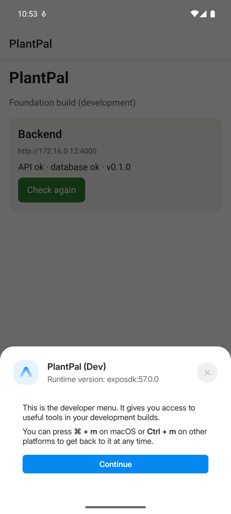
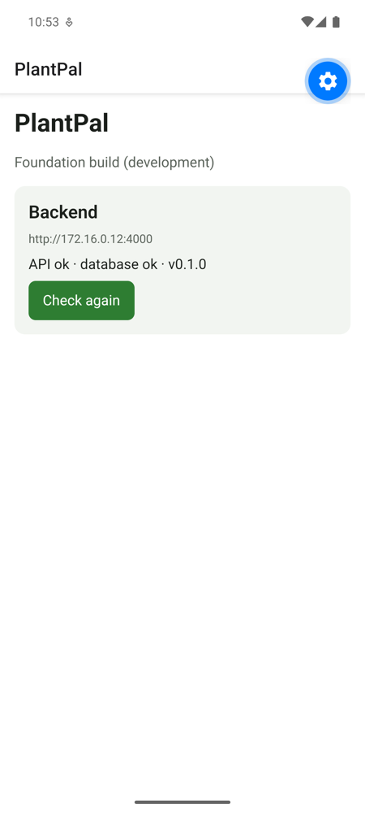

# M1: Foundation, evidence

Date: 2026-10-15 · Commit range: `6d28bcb..HEAD`

## What was built
| Piece | Where |
|---|---|
| pnpm workspace monorepo (`apps/mobile`, `apps/api`, `packages/shared`) | root `package.json`, `pnpm-workspace.yaml` |
| Expo SDK 57 app with a **development build** (`expo-dev-client`), not Expo Go | `apps/mobile/app.config.ts` |
| Three app variants (development / preview / production), each with its own bundle id and scheme | `apps/mobile/app.config.ts`, `apps/mobile/eas.json` |
| Expo Router, TypeScript strict + `noUncheckedIndexedAccess` | `apps/mobile/src/app/`, `tsconfig.json` |
| ESLint (`eslint-config-expo`) + Prettier | `apps/mobile/eslint.config.js`, `.prettierrc` |
| Theme tokens (light/dark), `Text` and `Screen` components | `apps/mobile/src/ui/` |
| Typed API client: Zod-validated responses, one `ApiError` type, timeout | `apps/mobile/src/api/client.ts` |
| Environment config validated at startup; dev auto-detects the API host | `apps/mobile/src/config/` |
| Shared API contract (Zod) | `packages/shared/src/` |
| Next.js 16 API, Drizzle + postgres.js, `GET /api/health` with a DB check | `apps/api/src/` |
| Local Postgres 17 in Docker | `docker-compose.yml` |
| CI: secret scan (gitleaks), lint, typecheck, tests with a Postgres service | `.github/workflows/ci.yml` |
| Manual EAS build workflow | `.github/workflows/eas-build.yml` |

## How to reproduce
```sh
pnpm install
docker compose up -d --wait
cp apps/api/.env.example apps/api/.env.local
cp apps/api/.env.test.example apps/api/.env.test.local
pnpm lint && pnpm typecheck && pnpm test

pnpm --filter @plantpal/api dev            # :4000
curl localhost:4000/api/health             # {"status":"ok","db":"ok",...}
docker compose stop db && curl localhost:4000/api/health   # status "degraded", db "down"
docker compose start db

pnpm --filter @plantpal/mobile android     # builds and installs "PlantPal (Dev)"
pnpm --filter @plantpal/mobile start       # Metro
```

## Results (run on 2026-10-15, macOS, Android emulator API 35)
| Check | Result |
|---|---|
| `pnpm lint` (mobile + api) | ✅ 0 problems |
| `pnpm typecheck` (mobile + api + shared) | ✅ pass |
| `packages/shared` Vitest | ✅ 2/2 |
| `apps/api` Vitest (incl. real-Postgres integration test) | ✅ 4/4 |
| `apps/mobile` Jest + RNTL (API client, env, Home screen) | ✅ 11/11 |
| `npx expo-doctor` | ✅ 21/21 checks |
| `next build`: `/api/health` is dynamic (`ƒ`), not prerendered | ✅ |
| `curl /api/health`, DB up → `ok/ok`; DB stopped → `degraded/down`; `Cache-Control: no-store` | ✅ |
| `expo run:android`: Gradle debug build, installed as `com.samilabud.plantpal.dev` | ✅ BUILD SUCCESSFUL in 4m 41s |
| App on the emulator reaches the API over the LAN and shows `API ok · database ok` | ✅ screenshot below |




## Not proven yet (honest list)
- **iOS build**: blocked locally until Xcode is updated from 26.2 to ≥ 26.4 (SDK 57 requirement). Then run `pnpm --filter @plantpal/mobile ios`.
- **EAS cloud builds**: `eas.json` is ready, but the project isn't linked to an Expo account yet (`eas login` + `eas init` are yours to run).
- **CI on GitHub**: the workflow exists but hasn't run, because nothing is pushed (no remote, as agreed).

## Docs used
- Expo: [SDK reference](https://docs.expo.dev/versions/latest/), [monorepos](https://docs.expo.dev/guides/monorepos/), [ESLint](https://docs.expo.dev/guides/using-eslint/), [unit testing](https://docs.expo.dev/develop/unit-testing/), [environment variables](https://docs.expo.dev/guides/environment-variables/), [app variants](https://docs.expo.dev/tutorial/eas/multiple-app-variants/), [development builds](https://docs.expo.dev/develop/development-builds/create-a-build/), [eas.json](https://docs.expo.dev/build/eas-json/) + [schema](https://docs.expo.dev/eas/json/)
- Next.js 16 bundled docs: `route-handlers.md` (Cache Components + `connection()`), `environment-variables.md` (`@next/env`), [create-next-app](https://nextjs.org/docs/app/api-reference/cli/create-next-app)
- Drizzle: [connect Neon](https://orm.drizzle.team/docs/connect-neon)
- React Native Testing Library v14 migration guide (bundled): async `render` / `fireEvent`
