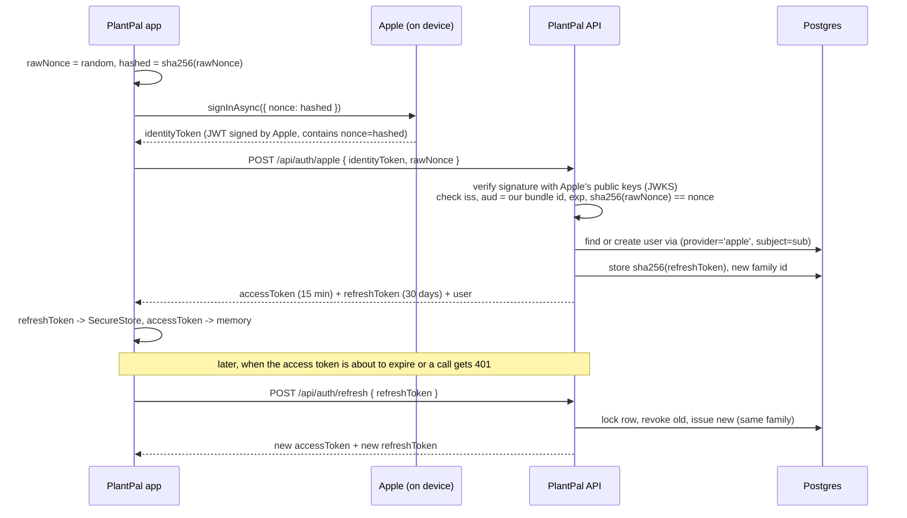
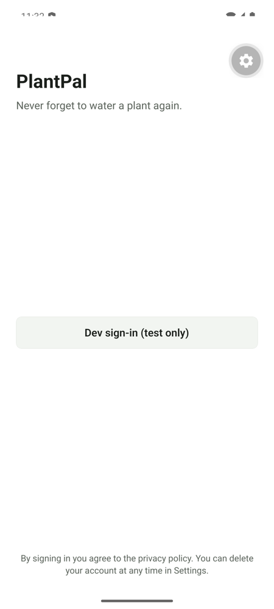
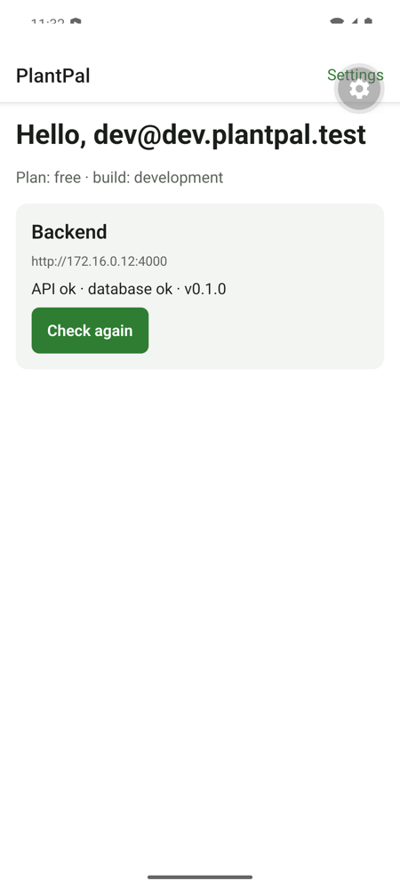
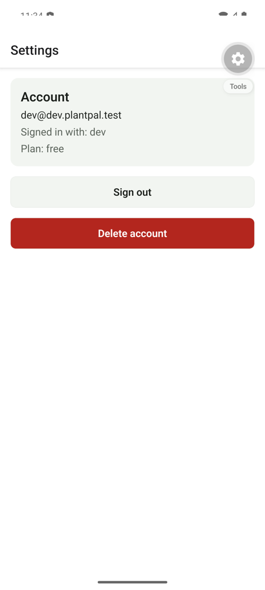

# M2: Mobile auth, evidence

Date: 2026-10-15 · Commits `6e14d26`, `e3582fa`, `8c916f2`

## What was built
| Capability | Where |
|---|---|
| Sign in with Apple (native, nonce-protected) | `apps/mobile/src/auth/providers/apple.ts`, `apps/api/src/app/api/auth/apple/route.ts` |
| Sign in with Google (native, ID token) | `apps/mobile/src/auth/providers/google.ts`, `apps/api/src/app/api/auth/google/route.ts` |
| Server verification of both ID tokens (JWKS signature, iss, aud, exp, nonce / email_verified) | `apps/api/src/auth/id-tokens.ts` |
| Our own session: 15-min access JWT + 30-day rotating refresh token, stored hashed | `apps/api/src/auth/access-token.ts`, `refresh-tokens.ts` |
| Refresh-token reuse detection (revokes the whole token family) | `rotateRefreshToken` |
| Secure storage: refresh token in Keychain/Keystore, access token in memory only | `apps/mobile/src/auth/token-store.ts` |
| Auto refresh: proactive before expiry + one retry after 401, single-flight | `apps/mobile/src/auth/session.ts`, `src/api/client.ts` |
| Logout (revokes this device's token family) | `POST /api/auth/logout`, `signOut()` |
| Account deletion: data wiped (cascade), Apple grant revoked, Google access revoked | `DELETE /api/me`, `apple-revoke.ts`, `deleteAccount()` |
| Signed-in / signed-out screens with Expo Router `Stack.Protected` | `apps/mobile/src/app/_layout.tsx` |
| Test-only dev sign-in for Maestro, off by default and blocked on Vercel production | `POST /api/auth/dev`, `loadAuthConfig` |

## The flow (Sign in with Apple; Google is the same minus the nonce)



**In plain English:** Apple (or Google) proves *who* the user is, exactly once, with a signed token. The server checks that signature against Apple's published keys, then forgets about Apple and issues **its own** tokens. A short access token goes on every request. A long refresh token can only be used once: every refresh swaps it for a new one, and if an old one ever comes back, someone copied it, so that whole session is killed.

## Results
| Check | How | Result |
|---|---|---|
| ID token verification rejects wrong nonce, wrong aud, wrong iss, expired, unknown key | Vitest with a fake identity provider (our own RSA keys) | ✅ 9 tests |
| Refresh rotation, reuse detection, expiry, parallel refresh (only one wins), logout per family | Vitest on real Postgres (`plantpal_test`) | ✅ 6 tests |
| Full route flow: sign in → /me → refresh → logout; Apple; Google; delete wipes all rows | Vitest on real Postgres | ✅ 7 tests |
| Apple revoke: code exchange + revoke with a correct ES256 client secret | Vitest with mocked fetch | ✅ 2 tests |
| Config: dev auth off in production, JWT secret length, key newlines | Vitest | ✅ 4 tests |
| Over real HTTP (`curl`): sign in, /me 200, no token 401, rotation, **replay → session revoked**, newer token then 401, delete, /me 401 | manual, see M2 smoke script below | ✅ |
| Client: bearer header, 401 → one refresh → retry, no retry loop, public endpoints skip auth | Jest | ✅ 4 tests |
| Session: offline restore, single-flight refresh, 401 signs out, **network error keeps you signed in**, proactive refresh | Jest | ✅ 6 tests |
| Sign-in and Settings screens (dev sign-in, error, delete needs confirmation) | Jest + RNTL | ✅ 6 tests |
| **Android emulator:** signed out → sign-in screen; dev sign-in → home with the user; Settings shows the account | manual | ✅ screenshots |
| **Android emulator:** kill + relaunch → still signed in (SecureStore); the relaunch refreshed the token (DB shows the old token rotated) | manual + DB query | ✅ |
| Deep link `plantpal-dev://settings` opens a protected screen | manual | ✅ |
| Totals | `pnpm test` | ✅ 64 tests (shared 2, api 35, mobile 27) |





### Smoke script (real HTTP)
```sh
B=localhost:4000/api
S=$(curl -s -X POST $B/auth/dev -H 'content-type: application/json' -d '{"name":"smoke"}')
AT=$(echo $S | jq -r .tokens.accessToken); RT=$(echo $S | jq -r .tokens.refreshToken)
curl -s $B/me -H "authorization: Bearer $AT"                        # 200 + profile
RT2=$(curl -s -X POST $B/auth/refresh -H 'content-type: application/json' -d "{\"refreshToken\":\"$RT\"}" | jq -r .tokens.refreshToken)
curl -s -X POST $B/auth/refresh -H 'content-type: application/json' -d "{\"refreshToken\":\"$RT\"}"   # "reused; session revoked"
curl -s -X POST $B/auth/refresh -H 'content-type: application/json' -d "{\"refreshToken\":\"$RT2\"}"  # 401: family revoked
curl -s -X DELETE $B/me -H "authorization: Bearer $AT" -H 'content-type: application/json' -d '{}'     # {"deleted":true,...}
```

## Not proven yet (honest list)
- **Real Sign in with Apple** on an iPhone: needs Xcode ≥ 26.4 locally (or an EAS build), and the Sign in with Apple capability on the App ID.
- **Real Google sign-in**: needs the OAuth client ids below. The code is ready and hidden until `EXPO_PUBLIC_GOOGLE_WEB_CLIENT_ID` is set.
- **Apple grant revocation against Apple's real servers**: needs a Sign in with Apple key (.p8). Only covered by a mocked test today.
- **Sign out and delete account tapped on the emulator**: the emulator stopped responding (System UI ANR) because the host was overloaded (load average ≈ 30). Both flows pass in the API integration tests, the curl smoke run and the RNTL tests. Repeat by hand when the machine is idle; Maestro covers it at M6.
- **Rate limiting** on the auth endpoints: not built yet (loose end for M6/M7).

## Setup only you can do
1. **Google Cloud** → APIs & Services → Credentials (OAuth consent screen: External, app name PlantPal):
   - **Web** client: its id goes in `GOOGLE_CLIENT_IDS` (API) and `EXPO_PUBLIC_GOOGLE_WEB_CLIENT_ID` (app).
   - **Android** client: package `com.samilabud.plantpal.dev` + the debug SHA-1 (`cd apps/mobile/android && ./gradlew signingReport`). Add one per variant later (EAS keystores have their own SHA-1).
   - **iOS** client: bundle id `com.samilabud.plantpal.dev`. Its id goes in `EXPO_PUBLIC_GOOGLE_IOS_CLIENT_ID`, and the reversed id in `GOOGLE_IOS_URL_SCHEME`.
2. **Apple Developer** → Identifiers: register `com.samilabud.plantpal.dev` (and later `.preview` and the production id) with the **Sign in with Apple** capability. Optional, for revocation: Keys → new key with Sign in with Apple → download the .p8 **once** and keep it out of git. Team ID, Key ID and key contents go in the API env (`APPLE_TEAM_ID`, `APPLE_KEY_ID`, `APPLE_PRIVATE_KEY`).

## Docs used
- Expo SDK 57: [AppleAuthentication](https://docs.expo.dev/versions/v57.0.0/sdk/apple-authentication/), [SecureStore](https://docs.expo.dev/versions/v57.0.0/sdk/securestore/), [Protected routes](https://docs.expo.dev/router/advanced/protected/), `expo-crypto` type definitions (installed)
- Google Sign-In: [Expo setup](https://react-native-google-signin.github.io/docs/setting-up/expo), [Original API](https://react-native-google-signin.github.io/docs/original), installed `types.d.ts` and plugin source (no-Firebase plugin only adds the iOS URL scheme)
- Apple: [Verifying a user](https://developer.apple.com/documentation/signinwithapple/verifying-a-user), [Generate and validate tokens](https://developer.apple.com/documentation/signinwithapplerestapi/generate-and-validate-tokens), [Revoke tokens](https://developer.apple.com/documentation/signinwithapplerestapi/revoke-tokens), [Creating a client secret](https://developer.apple.com/documentation/accountorganizationaldatasharing/creating-a-client-secret)
- `jose` 6 and `drizzle-orm` 0.45 installed type definitions; RNTL v14 migration guide (bundled)
