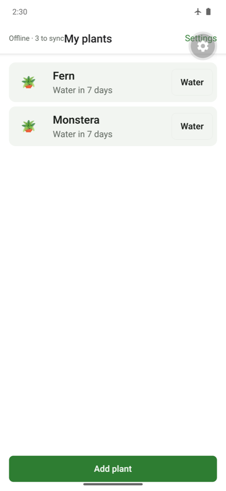
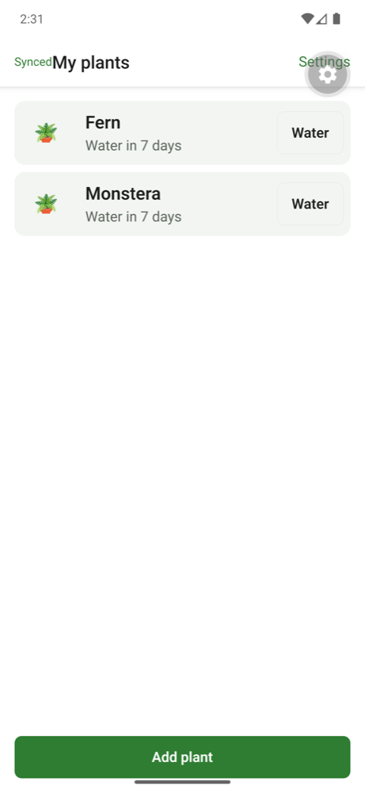
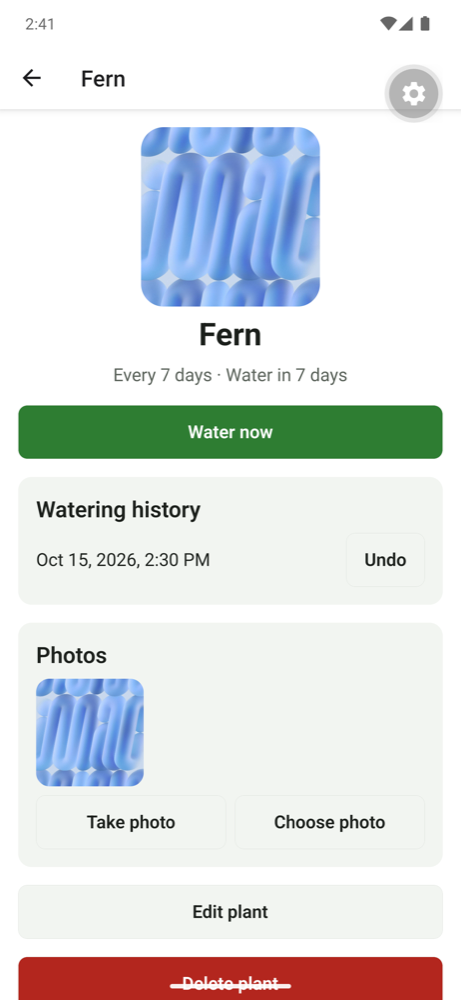
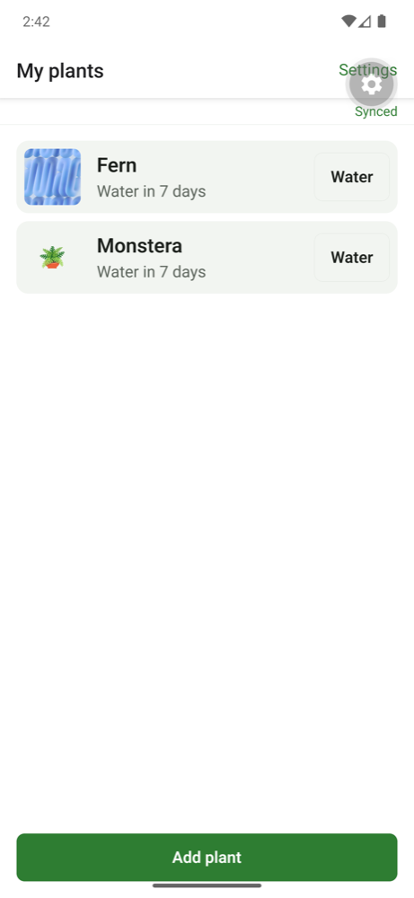

# M3: Core features and offline sync, evidence

Date: 2026-10-15 · Commits `82e2f75..HEAD`

## What was built
| Capability | Where |
|---|---|
| Plants CRUD, watering (append-only events), watering history, photo history | `apps/mobile/src/data/plants.ts`, `src/app/index.tsx`, `src/app/plants/` |
| **SQLite as the local source of truth** (expo-sqlite, `PRAGMA user_version` migrations, WAL) | `apps/mobile/src/db/` |
| Outbox: every write updates the row and queues the change in **one** transaction; edits to the same row collapse | `apps/mobile/src/data/outbox.ts` |
| Sync engine: push + pull rounds applied atomically, in-flight edits survive, pending local edits beat pulled rows, pages until caught up | `apps/mobile/src/sync/engine.ts` |
| Sync triggers: app start, network back, app to foreground, 1.5 s after a local write, pull-to-refresh, tap the badge | `apps/mobile/src/sync/sync-manager.ts` |
| Sync endpoint with a change log (`server_version` from one sequence) and **last-write-wins** on `clientUpdatedAt` | `apps/api/src/sync/sync-service.ts`, `POST /api/sync` |
| Camera / library → square crop → max 1280 px → JPEG 70% → app documents folder | `apps/mobile/src/photos/capture.ts` |
| Private photo storage: presigned upload/view URLs (Vercel Blob, OIDC, no long-lived token) | `apps/api/src/storage/photos.ts`, `/api/photos/*` |
| Upload-then-sync: a photo row reaches the server only after its file does | `apps/mobile/src/sync/photo-uploader.ts` |
| Local data belongs to one user: wiped on sign-out/delete, and if a different account signs in | `apps/mobile/src/auth/session.ts` |

## The conflict rule, and its trade-off
**Rule:** for the same row, the edit with the later `clientUpdatedAt` (the phone's clock at the moment of the edit) wins. The server enforces it in one SQL statement: `INSERT … ON CONFLICT DO UPDATE … WHERE user_id = me AND client_updated_at < incoming`.

**Why it's good enough here:** one person, a few devices, small records (a plant's name and interval). It's simple to reason about and to test, and every device ends up with the same data.

**What it costs:**
- **A lost edit is possible.** If two phones rename the same plant offline, the later rename wins and the earlier one is silently dropped. A per-field merge or CRDTs would avoid that, at a big cost in complexity.
- **It trusts phone clocks.** That's limited by a clamp: a time more than 60 s in the future is treated as "now", so a phone with a wrong clock can't win forever.

**Designed so conflicts mostly can't happen:**
- **Watering is an immutable event, not an edit.** Two phones watering offline means two events, both kept.
- **Deletes are tombstones,** so they sync like edits. A plant delete cascades to its waterings and photos on the server.
- **A per-user advisory lock** makes "commit order = version order", so a pulling device can never skip a row whose version number was assigned earlier but committed later.

## Results
| Check | How | Result |
|---|---|---|
| Sync service: create/pull, cursor, LWW both ways, future-clock clamp, foreign rows (forbidden, no leak), tombstone cascade, unknown delete, invalid parent, two-phone waterings, idempotent retry, **510-row paging**, per-user isolation | Vitest on real Postgres | ✅ 12 tests |
| Photo URL routes: own folder only, size/type limits, foreign photo id 403 on upload / 404 on view, auth required | Vitest on real Postgres (Blob signing mocked) | ✅ 4 tests |
| Account deletion also deletes the user's photo files | Vitest | ✅ |
| Repository: atomic row + outbox, edit coalescing, watering, delete cascade, photo pending/cover | Jest on **real SQLite** (better-sqlite3 behind the same interface as expo-sqlite) | ✅ 6 tests |
| Engine: push/clear/apply/cursor, **edit during in-flight request survives**, paging, **offline = no change**, stale → server winner | Jest on real SQLite | ✅ 5 tests |
| Uploader: upload then queue, failure stays pending, missing file dropped + cover reset | Jest on real SQLite | ✅ 2 tests |
| Watering status, list screen, form validation, sync badge states, unsynced-changes warning on sign-out | Jest + RNTL | ✅ |
| **Two-phone offline demo over real HTTP** (script below) | `node apps/api/scripts/demo-offline-sync.mjs` | ✅ 7/7 PASS |
| Totals | `pnpm test` | ✅ **108 tests** (shared 2, api 51, mobile 55) |

### Airplane-mode test on the Android emulator (2026-10-15)
| Step | Phone | Server (Postgres) |
|---|---|---|
| 1. Online: add "Monstera" | listed, badge **Synced** | `Monstera` |
| 2. **Airplane mode ON** (`adb shell cmd connectivity airplane-mode enable`); add "Fern", water both | both listed and updated instantly; badge **Offline · 3 to sync** | still only `Monstera`, **0 waterings** |
| 3. **Airplane mode OFF**, no taps | badge back to **Synced** | `Fern, Monstera`, **2 waterings**, about **4 s** after reconnecting |
| 4. Fern → Choose photo (a 9.3 MB JPEG) → crop | photo shows at once from the local file | upload URL 200 → file in Blob → photo row + cover synced |
| 5. Photo privacy | | signed GET **200** (`image/jpeg`, **86,642 bytes**); same URL unsigned **403**; another user **404** |






### Reproduce the offline-then-sync behaviour (no phone needed)
```sh
pnpm --filter @plantpal/api dev            # local API
node apps/api/scripts/demo-offline-sync.mjs
```
Two simulated phones (same user) go offline, rename the same plant at different times, both water it, then reconnect. The output must end with every line `PASS`: the older rename is rejected as stale, both phones converge on the winner, both waterings survive, and a delete tombstones the plant and its waterings on the other phone.

### Reproduce on the emulator
```sh
pnpm --filter @plantpal/mobile android && pnpm --filter @plantpal/mobile start
adb shell cmd connectivity airplane-mode enable    # add/water plants: badge shows "Offline · N to sync"
adb shell cmd connectivity airplane-mode disable   # badge returns to "Synced" by itself within seconds
```

## Bugs found by testing on the device (and fixed)
- **Photos were saved with the temporary cache path.** I relied on `File.move()` updating the source object's `uri`; the fix keeps a reference to the destination. Unit tests couldn't catch this because they don't run the native file system, so this is exactly why the emulator run matters.
- **A photo whose file is missing waited forever.** Now it's dropped and the cover reset.
- **The list thumbnail asked for a signed URL** even when the file was on the phone, and cached the 404 from before the upload finished. Now the list uses the local file.
- **The sync badge collided with the screen title.** It moved to its own row.
- **Test-setup lesson:** starting Metro with `CI=1` turns off file watching, so the phone kept running old code. The scripts now start Metro without it.

## Not done / loose ends
- **Blob files of deleted photos and plants** stay in storage until account deletion (rows are tombstoned). A cleanup job is a loose end.
- **Rename conflicts lose the older edit** (by design, above). There's no conflict UI.
- **No background sync while the app is closed.** Sync runs when the app is opened or brought back. Background fetch could come later; local reminders (M4) don't need the network.
- **Free plan limits** (unlimited plants, photo history) are enforced in M5, not yet.
- **The M3 server code isn't on Vercel yet:** commits are local until you say "push". Pushing to `main` deploys to production and runs the new migration on Neon.

## Docs used
- Expo SDK 57: [SQLite](https://docs.expo.dev/versions/v57.0.0/sdk/sqlite/) (user_version migrations, `withExclusiveTransactionAsync`, WAL), [ImagePicker](https://docs.expo.dev/versions/v57.0.0/sdk/imagepicker/), [ImageManipulator](https://docs.expo.dev/versions/v57.0.0/sdk/imagemanipulator/) (new contextual API; `manipulateAsync` deprecated), [FileSystem](https://docs.expo.dev/versions/v57.0.0/sdk/filesystem/) (`File`/`Directory`/`Paths`, File as fetch body), [NetInfo](https://docs.expo.dev/versions/v57.0.0/sdk/netinfo/); installed type definitions for all of them
- Vercel Blob: [Client uploads](https://vercel.com/docs/vercel-blob/client-upload), [Signed URLs](https://vercel.com/docs/vercel-blob/vercel-signed-urls) (`issueSignedToken`, `presignUrl`, OIDC)
- Drizzle 0.45 installed types (`onConflictDoUpdate` with `setWhere`, `pgSequence`)
