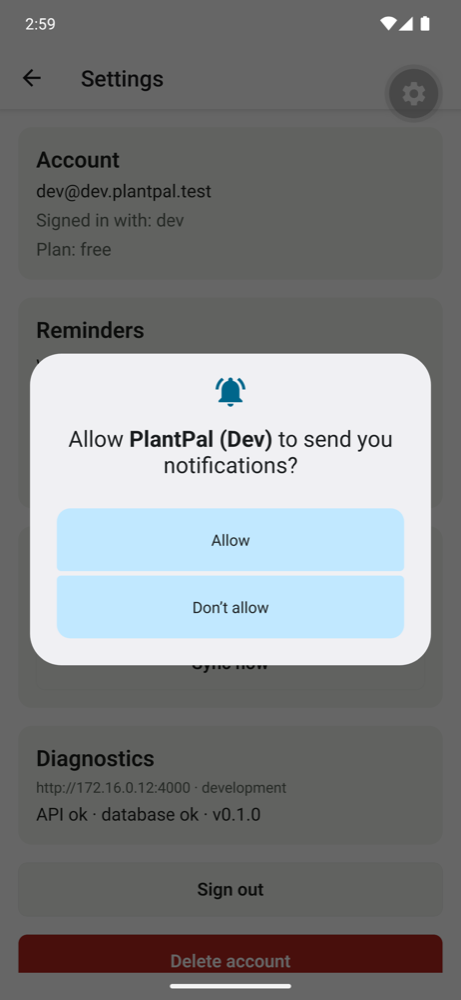
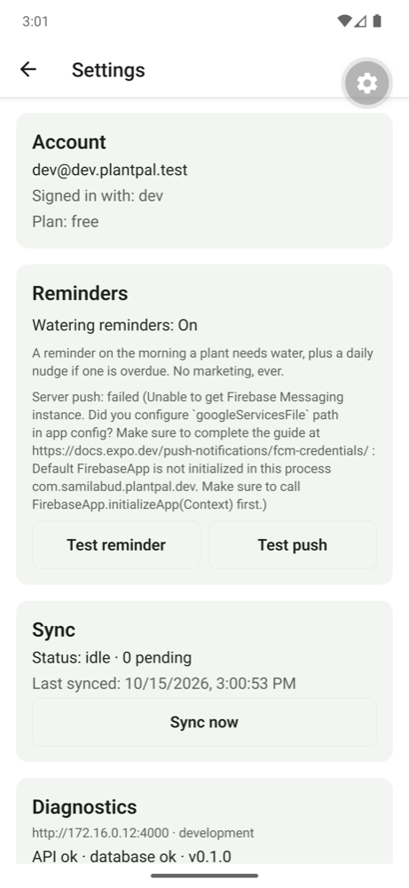
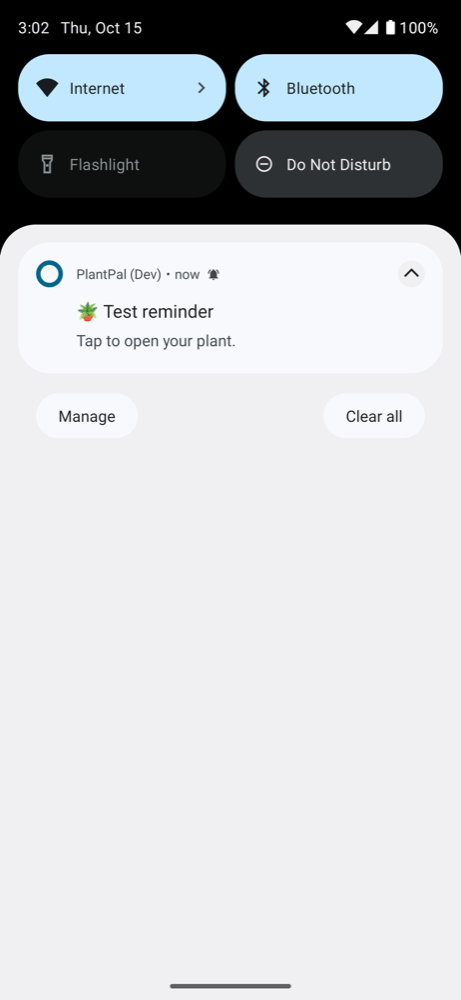
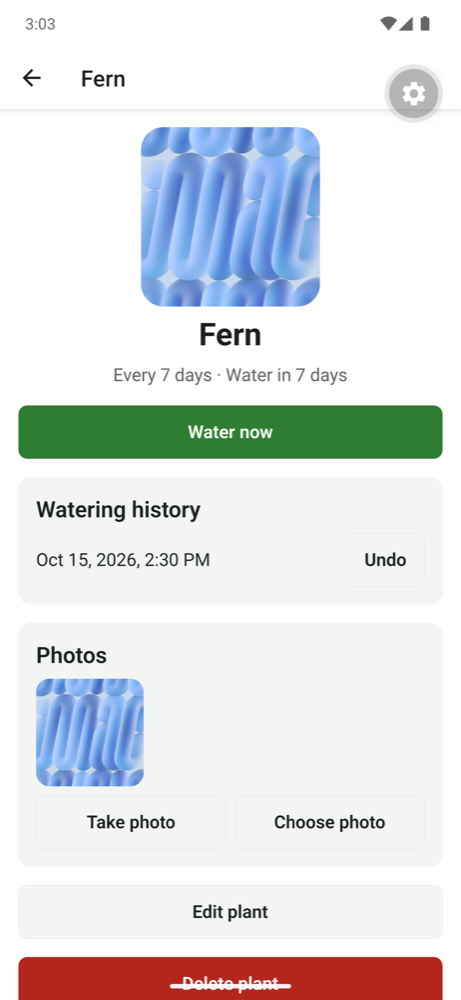

# M4: Notifications, evidence

Date: 2026-10-15 · Commits `a57923e..HEAD`

## What was built
| Capability | Where |
|---|---|
| Permission flow: soft ask after the first plant, Settings card, "blocked" → system settings, Android channel created before asking | `apps/mobile/src/notifications/notifications.ts`, `soft-ask.ts`, `src/components/reminders-card.tsx` |
| **Local scheduled reminders** at 9:00 on the due day, rebuilt from SQLite after every change, max 60 (iOS keeps 64) | `src/notifications/plan.ts` (pure), `syncLocalReminders()` |
| **Device token registration**: Expo push token (EAS project `@samilabud/plantpal`) → `POST /api/devices`; unregistered on sign-out | `src/notifications/push-registration.ts`, `apps/api/src/app/api/devices/route.ts` |
| **Remote push from the backend**: batches of 100 to Expo, dead-token cleanup from tickets and from receipts 15 min later | `apps/api/src/push/expo-push.ts` |
| **Daily cron** (Vercel Hobby = once a day): digest of plants overdue 12h+; `CRON_SECRET` checked in constant time | `apps/api/src/app/api/cron/reminders/route.ts`, `vercel.json` |
| **Manual trigger** `POST /api/push/test` (pushes to my devices; never available on production) | `apps/api/src/app/api/push/test/route.ts` |
| **Notification tap → deep link** to the plant, app running or closed (cold start) | `src/notifications/use-notifications.ts` |

## How the pieces fit (and why two kinds of notifications)
```
Local reminders (on the phone)            Remote push (from the server)
  SQLite plants ─► planReminders()          Vercel Cron (daily) ─► /api/cron/reminders
  ─► OS alarm at 9:00 on the due day          ─► overdue plants per user ─► devices
  works offline, exact time                   ─► Expo Push API ─► FCM (Android) / APNs (iOS)
                                              catches what the phone can't (other device
                                              edited the plant, reminders lost on reinstall)
Both carry data: { url: "/plants/<id>" } ─► tap ─► router.push(url)
```
- **Expo push service:** it's a relay. Our server sends one HTTP request to Expo. Expo holds the real FCM key (Android) and APNs key (iOS) and forwards the message. Without Expo, our server would need both providers' credentials and two APIs.
- **FCM** (Firebase Cloud Messaging) delivers to Android through Google Play services. **APNs** (Apple Push Notification service) delivers to iPhones. Both need the app's credentials, registered once with EAS.
- **Tickets vs receipts:** a ticket means "Expo accepted it". A receipt, about 15 minutes later, means "FCM/APNs accepted it or rejected it". `DeviceNotRegistered` in either means the app was uninstalled, so the server forgets that token.

## Results
| Check | How | Result |
|---|---|---|
| Sender: batches of 100, tickets stored, `DeviceNotRegistered` → token removed (ticket and receipt paths), recent tickets wait 15 min | Vitest on real Postgres, Expo API faked | ✅ 3 tests |
| Overdue query (12h+, ignores watered and deleted plants) and digest wording / deep links | Vitest on real Postgres | ✅ 3 tests |
| Device registration moves a token to the new account; unregister only my own; bad token → 400 | Vitest | ✅ 2 tests |
| Cron: 401 without/with the wrong secret; runs with it; manual trigger deep-links | Vitest | ✅ 3 tests |
| Reminder planning: 9:00 on the due day, overdue → next 9:00, never in the past, cap + order | Jest | ✅ 4 tests |
| Tap payload parsing: only in-app paths, only taps (not other actions) | Jest | ✅ 2 tests |
| **Real Expo Push API:** fake token registered → manual trigger → Expo rejects it → server deletes it | curl against the local API | ✅ `{"accepted":0,"failed":1,"removedTokens":1}`, devices 1 → 0 |
| Cron route over HTTP: no secret → 401; with secret → runs | curl | ✅ |
| **Android emulator:** "Turn on reminders" → system prompt → Allow → status On, **6 alarms** scheduled | manual + `dumpsys alarm` | ✅ |
| **Android emulator:** test reminder with the app in background → shown on channel `reminders` → tap → **opens Fern** | manual | ✅ |
| **Android emulator, cold start:** process killed (`am kill`, alarms kept) → reminder fires → tap → app launches → **opens Fern** | manual | ✅ |
| Totals | `pnpm test` | ✅ **125 tests** (shared 2, api 62, mobile 61) |







## Testing on a real phone
1. Install a development build: `pnpm --filter @plantpal/mobile android -- --device` (USB debugging on), or an EAS `development` build.
2. Sign in, add a plant, accept the reminder prompt. Settings → Reminders must say **On** and **Server push: registered**.
3. **Local:** Settings → *Test reminder*, lock the phone, wait about 10 s, tap it, and the plant opens.
4. **Remote:** Settings → *Test push* (development builds only): the phone gets "🪴 Test reminder" from the server. Tap it.
5. **Cold start:** swipe the app away, run *Test push* from another device or with curl (`POST /api/push/test` with your token), tap it.
6. **Daily digest:** water a plant with a 1-day interval and wait two days, or call `/api/cron/reminders` with `Authorization: Bearer $CRON_SECRET` against a preview.

## Not proven yet (honest list)
- **Remote push delivered to a device:** blocked on Firebase (FCM V1) credentials. The app reports exactly that: *"Default FirebaseApp is not initialized… configure googleServicesFile"*. The server side is proven against the real Expo API, as above.
- **iOS:** local and remote notifications not tested. That needs Xcode ≥ 26.4 (or an EAS build), your iPhone and an APNs key through `eas credentials`.
- **Production cron run:** `CRON_SECRET` is set on Vercel. The cron goes live with the next production deploy (needs your "push").
- **Notification icon:** the Android default is used; a monochrome 96×96 icon is a polish item for M7.
- **Dev-only observation:** after a native reinstall (`expo run:android`) the app came up signed out. Restarts keep the session (proven in M2). Being investigated as a loose end.

## Docs used
- Expo: [Push notifications setup](https://docs.expo.dev/push-notifications/push-notifications-setup/), [Notifications SDK 57](https://docs.expo.dev/versions/v57.0.0/sdk/notifications/) (date triggers, permissions, response listeners, config plugin), [Sending notifications](https://docs.expo.dev/push-notifications/sending-notifications/) (tickets, receipts, error codes, access token), [FCM V1 credentials](https://docs.expo.dev/push-notifications/fcm-credentials/)
- Vercel: [Cron jobs](https://vercel.com/docs/cron-jobs), [Managing cron jobs](https://vercel.com/docs/cron-jobs/manage-cron-jobs) (`CRON_SECRET`, best-effort delivery, idempotency), [Usage and pricing](https://vercel.com/docs/cron-jobs/usage-and-pricing) (Hobby: daily, ±59 min)
