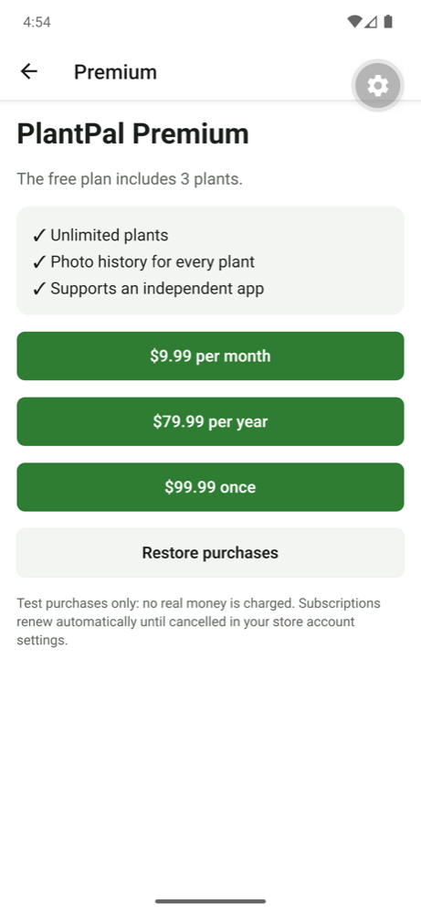
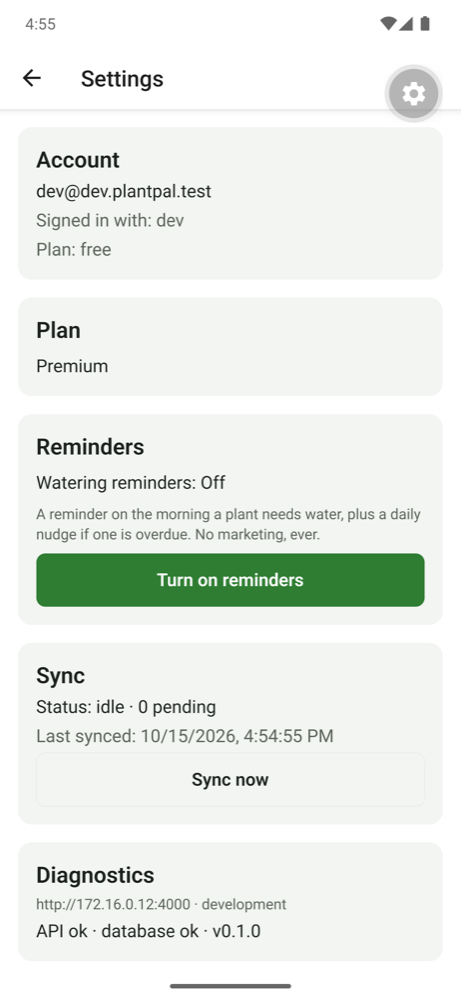

# M5: Subscriptions (RevenueCat, sandbox), evidence

Date: 2026-10-15 · Commits `14a37f6..HEAD`

> **Sandbox only.** All purchases here are RevenueCat **Test Store** purchases: no money, no real users, no revenue.

## What was built
| Capability | Where |
|---|---|
| RevenueCat SDK, customer identified with **our user id** (webhooks map straight to users) | `apps/mobile/src/purchases/purchases.ts` |
| Test Store key read only in `__DEV__` (RevenueCat crashes release builds that ship it) | `apiKey()` |
| Paywall: offerings with store prices, purchase, cancel handling, **restore purchases** | `apps/mobile/src/app/paywall.tsx` |
| Plan card in Settings: usage ("2 of 3 plants") / Premium + **Manage subscription** | `src/components/plan-card.tsx` |
| Free plan: **3 plants, 1 photo per plant**; Premium: unlimited plants + photo history | `packages/shared/src/plans.ts` |
| **Entitlement check on the device** (instant UI) **and on the server** (what's enforced) | `src/purchases/limits.ts`, `apps/api/src/billing/plan.ts` |
| Server enforcement in `/api/sync` (`limit` rejection); data stays editable after a downgrade | `apps/api/src/sync/sync-service.ts` |
| **Webhook** `POST /api/webhooks/revenuecat`: Authorization header and/or HMAC-SHA256 over the raw body (5-min window), constant-time, fail closed | `apps/api/src/billing/webhook.ts`, route |
| **Idempotency** by event id (`webhook_events`), safe retries | webhook route |
| Source of truth = RevenueCat's customer record (`GET /v1/subscribers`), read after every webhook | `apps/api/src/billing/revenuecat.ts` |
| `POST /api/subscription/sync`: the app asks the server to re-check right after buying/restoring | route |

## How it works
```
Phone                                     RevenueCat                     PlantPal API (Vercel + Neon)
Purchases.configure({ appUserID: <our user id> })
buy(package) ───────────────────────────► Test Store / store ──┐
      ◄──────── CustomerInfo (premium active) ─────────────────┤
UI unlocks immediately (device entitlement)                    │
POST /api/subscription/sync ──────────────────────────────────────────────► GET /v1/subscribers/<id>
                                                               │            ─► users.plan = premium (+ expiry)
                                          webhook (renewals,   └─────────► POST /api/webhooks/revenuecat
                                          expiry, refunds…)                   verify → record id → re-read
                                                                              customer → update plan
Server enforces limits in /api/sync from users.plan (expired = free)
```
- **Why re-read instead of trusting the event:** events arrive "at least once", possibly out of order. Reading the current customer record makes processing idempotent and order-independent. An old `EXPIRATION` arriving after a `RENEWAL` can't downgrade anyone (tested).
- **Why the phone never tells the server "I'm Premium":** a modified app could lie. The server only believes RevenueCat's API, so free limits hold even against a tampered client.
- **Why in-app purchase and not Stripe:** Apple and Google require their in-app purchase systems for digital goods used inside the app. RevenueCat wraps both stores (plus the Test Store) behind one SDK and one webhook.

## Results
| Check | How | Result |
|---|---|---|
| Signature/auth: valid accepted; tampered body, wrong secret, wrong header, missing signature, **5-min replay window**, nothing configured → fail closed | Vitest | ✅ 5 tests |
| **Replay test:** the same event id delivered twice → processed once, RevenueCat called once | Vitest on real Postgres | ✅ |
| **Out of order:** `EXPIRATION` after `RENEWAL` doesn't downgrade (state read from RevenueCat) | Vitest | ✅ |
| RevenueCat down → non-200 → **retry processes** the event | Vitest | ✅ |
| Unknown / anonymous ids ignored; transfers refresh both sides | Vitest | ✅ |
| Free limits: 4th plant and 2nd photo rejected; premium unlimited; expired premium = free; existing data editable after downgrade | Vitest on real Postgres | ✅ 5 tests |
| Paywall: reason text, store prices, success closes, **cancel is not an error**, restore message | Jest + RNTL | ✅ 4 tests |
| Engine removes rows the server refused with `limit` | Jest on real SQLite | ✅ |
| Totals | `pnpm test` | ✅ **152 tests** (shared 2, api 82, mobile 68) |

### Live, against RevenueCat's real API (2026-10-15, Android emulator + local API)
| Time (UTC) | Step | Result |
|---|---|---|
| 20:54 | Paywall loads the `default` offering from RevenueCat | $9.99/month, $79.99/year, $99.99 lifetime (Test Store prices) |
| 20:54 | Tap Monthly → Test Store purchase | "Welcome to Premium 🌿"; Plan card **Premium** (device entitlement) |
| 20:54 | Server re-check before the server key existed | `503 billing_not_configured`, **not** shown as a purchase failure; server stayed **free** |
| 21:01 | `POST /api/subscription/sync` with the key configured | server → **premium** until 21:04:37 |
| 21:04 → 21:19 | Test Store auto-renewals (5 × 5 min) | each re-check pushed the expiry forward (21:19:37 = purchase + 25 min) |
| 21:20 | Re-check after the last period | server → **free**, `planExpiresAt: null` |

### Production webhook
| Check | Result |
|---|---|
| Endpoint deployed (`/api/webhooks/revenuecat`) | ✅ |
| No verification configured | `503 webhook_not_configured` (fails closed) |
| Wrong / missing Authorization header | `401` |
| RevenueCat dashboard **"Send test webhook"** (SANDBOX event) → production | ✅ **200** |




## Replay test you can run
```sh
pnpm --filter @plantpal/api test -- webhook   # replay, tamper, stale signature, out-of-order, retry
```

## Sandbox purchase checklist (Test Store; App Store / Play sandbox in M7)
- [x] Offering `default` is current, with Monthly / Annual (+ Lifetime) packages → entitlement **`premium`**
- [x] Development build with `EXPO_PUBLIC_REVENUECAT_TEST_KEY` (never in release builds)
- [x] Sign in → paywall → buy → device shows Premium instantly
- [x] Server re-check → `users.plan = premium` with the expiry from RevenueCat
- [x] Renewals extend the expiry; after the last one the server returns to **free**
- [x] Restore purchases button (unit-tested; manual run pending)
- [x] Webhook: RevenueCat test event → production **200**
- [ ] Store sandbox (Apple sandbox tester / Play license tester) → M7, needs store apps and products

## Not proven yet (honest list)
- **Webhook-driven plan change in production for a real user:** the emulator signs in against the *local* API, so production receives valid events for a user it doesn't have (`users: 0`, correct). Needs a production sign-in (Google/Apple, M7). The same code path is proven by the replay tests and the local re-check runs.
- **App Store / Google Play sandbox purchases:** need store apps, products and testers (M7).
- **HMAC signing:** the RevenueCat dashboard didn't offer the toggle on this account, so production uses the Authorization header. The HMAC path is implemented and tested, and turns on by setting `REVENUECAT_WEBHOOK_SECRET` if RevenueCat enables it.
- **Server key type:** the server currently uses the public Test Store key, which RevenueCat accepts for reading customers. Swap to an `sk_` secret key (and add it to Preview).
- **Manual restore on the device** not run yet (unit-tested).

## Docs used
- RevenueCat: [Test Store](https://www.revenuecat.com/docs/test-and-launch/sandbox/test-store), [Expo installation](https://www.revenuecat.com/docs/getting-started/installation/expo), [Webhooks](https://www.revenuecat.com/docs/integrations/webhooks) (auth header, HMAC `t=…,v1=…` over `"<t>.<raw body>"`, retries, "call GET /subscribers after any webhook"), [Event types and fields](https://www.revenuecat.com/docs/integrations/webhooks/event-types-and-fields), [REST v1 customers](https://www.revenuecat.com/docs/api-v1/customers); installed `react-native-purchases` 10.14 / `purchases-typescript-internal` type definitions
