# M9: AI plant identification and Spanish, evidence

Plan and decisions: [`M9_PLAN.md`](../M9_PLAN.md). This file grows with each sub-milestone.

## M9.1: API (2026-10-19)

### What was built
| Piece | Where |
|---|---|
| Shared contract: `IdentifyResult` (the answer schema), request/response, limits, report | `packages/shared/src/identify.ts` |
| The Claude call: structured output, image first, one retry, refusal and timeout handling | `apps/api/src/ai/identify.ts` |
| The prompt, with the reasoning behind each rule | `apps/api/src/ai/prompt.ts` |
| Cost per call (fallbacks priced per model) | `apps/api/src/ai/pricing.ts` |
| Per-user limits and the daily spending guard, race-safe | `apps/api/src/ai/limits.ts` |
| `POST /api/plants/identify`, `POST /api/plants/identify/report` | `apps/api/src/app/api/plants/identify/` |
| Tables `ai_identifications`, `ai_reports` | `apps/api/drizzle/0004_ai.sql` |
| Evaluation photos, script and results | `apps/api/scripts/eval*` |

Docs used: Anthropic [Vision](https://platform.claude.com/docs/en/build-with-claude/vision)
(image tokens = ⌈w/28⌉ × ⌈h/28⌉), the Claude API reference bundled with Claude Code (structured
outputs, Sonnet 5.5 thinking rules, server-side fallback), the SDK's own source for
`messages.parse` behavior, and Next.js 16's bundled docs for `maxDuration`.

### Decisions made while building (not in the plan)
- **`messages.create` + our own validation instead of `messages.parse`.** Reading the SDK
  (0.131.0) showed `parse()` throws when the answer fails validation, and the token usage of that
  call is lost. A failed answer is still billed, so we validate the JSON ourselves and always
  record usage.
- **Schema field order matters.** In the first evaluation, Sonnet 5.5 left a stray `}` at the end
  of `careTip`, the last field, in 16 of 125 answers (Haiku: 0). Moving `confidence` (a
  fixed-choice field) to the end brought it to **0 of 125**. A server-side cleanup stays as a
  safety net, counted as `textRepairs` in every log line.
- **One TypeScript for the workspace.** Adding the SDK made pnpm re-resolve Expo's TypeScript
  peer to the API's 5.9 instead of the app's 6.0, which created a second copy of the Expo graph
  and broke a mobile test suite. The API now uses TypeScript ~6.0.3 like the app and
  `packages/shared`; the lockfile got smaller and every check passes. Same class of bug as the
  two-React problem found in M8.
- **SDK pinned to 0.131.0** (released 2026-09-30), not the 4-day-old 0.135.0.
- **The evaluation script is TypeScript** (`eval-identify.ts`, run with `tsx`), not `.mjs` as the
  brief said, so it imports the exact prompt and request code the route uses instead of a copy.
- **`devices.language` moves to M9.3,** where it's used (server push texts). Adding the column
  now would be dead code.

### Tests (mocked Anthropic: the real SDK over a fake network)
`apps/api/src/app/api/plants/identify/identify.test.ts` and `src/ai/pricing.test.ts`, 25 tests:

| Brief case | Test |
|---|---|
| Success | Suggestion returned; status, tokens and cost recorded; nothing about the photo stored |
| Request shape | Image first, language line, JSON schema without numeric ranges, `fallbacks: "default"` + beta header; no fallback sent to Haiku |
| Low confidence | Passed through with status `low_confidence` (the app won't pre-fill it) |
| Not a plant | Every field blanked even if the model filled some |
| Invalid model output | Retried once (both calls' usage recorded); 502 `ai_invalid_output` after two |
| Refusal | Treated as "not sure", no retry |
| Timeout | Gives up at the deadline with status `timeout` |
| Anthropic down | 502 `ai_unavailable`, not counted against the user |
| Limit reached | Free 3/day with `resetsAt`; Premium 100/month; Premium shows day and month remaining |
| Race | 5 simultaneous requests on Free: exactly 3 pass |
| Spending guard | At `AI_DAILY_LIMIT` nobody reaches Claude (503 `ai_resting`) |
| Validation | Non-JPEG rejected before Claude; sign-in and a configured key required |
| Report | Own suggestion recorded; someone else's is a 404 |
| Account deletion | Identifications and reports are deleted with the account |

Whole repo: lint ✅, typecheck ✅, tests ✅ shared 2 · API 108 · mobile 105 = **215**. The same passes from a
fresh clone (`pnpm install --frozen-lockfile`, lint, typecheck, test).

### Evaluation
25 openly licensed photos from Wikimedia Commons (20 houseplants of 14 kinds, 3 non-plants, 2
deliberately blurred), cropped square and resized to 1024 px like the app. Authors and licenses:
[`sources.json`](../../apps/api/scripts/eval/sources.json). Watering ranges: the category from
[WVU Extension's houseplant care table](https://extension.wvu.edu/lawn-gardening-pests/indoor-plants/common-houseplant-care),
turned into days by our own judgment (listed in
[`cases.json`](../../apps/api/scripts/eval/cases.json) for review).

Scoring: **right** = correct species (or genus where only a genus is expected); **partly** =
right genus only; **unsure** = the app wouldn't pre-fill (honest "not sure"); **wrong** =
confidently wrong, the harmful case. For blurry photos, saying "not sure" counts as right.

**English** (final prompt, [full results](../../apps/api/scripts/eval/results/2026-10-20T01-39-55-en.md)):

| Config | Plants right | Partly | Unsure | Wrong | Not-plant | Blurry | Interval in range | p50 | p95 | Cost / photo |
|---|---|---|---|---|---|---|---|---|---|---|
| A: Sonnet 5.5, low effort | **19/20** | 1 | 0 | **0** | 3/3 | 2/2 | 21/21 | 2.3 s | 8.9 s* | $0.0058 |
| B: Sonnet 5.5, no thinking | **19/20** | 1 | 0 | **0** | 3/3 | 2/2 | 21/21 | 2.3 s | 3.0 s | $0.0058 |
| C: Haiku 5.5, low effort | 16/20 | 2 | 2 | 0 | 3/3 | 2/2 | 20/20 | 1.5 s | 3.4 s | $0.0003 |

**Spanish** ([full results](../../apps/api/scripts/eval/results/2026-10-20T01-41-48-es.md)):

| Config | Plants right | Partly | Unsure | Wrong | Not-plant | Blurry | Interval in range | p50 | p95 | Cost / photo |
|---|---|---|---|---|---|---|---|---|---|---|
| A: Sonnet 5.5, low effort | **18/20** | 1 | 1 | **0** | 3/3 | 2/2 | 20/20 | 2.1 s | 2.9 s | $0.0059 |
| C: Haiku 5.5, low effort | 15/20 | 3 | 1 | 1 | 3/3 | 2/2 | 20/20 | 2.1 s | 4.0 s | $0.0004 |

\* One 11 s call (monstera-1, 92 output tokens: API-side latency, not thinking). Still inside the
15 s server budget. 25 photos is too few for a stable p95.

What the misses were:
- **Sonnet:** the *Mammillaria* was called *M. elongata* (genus right, species wrong) in every
  run; one variegated *Echeveria* got "low" confidence in Spanish.
- **Haiku:** a climbing pothos photographed in the wild called *Philodendron*, the African violet
  unsure in English and **confidently wrong in Spanish** (*Episcia*), and several genus-only
  answers (*Philodendron sp.*, *Aloe sp.*).
- Spanish names were natural (*Costilla de Adán*, *Lengua de suegra*, *Cuna de Moisés*,
  *Árbol de jade*) and tips used "tú". The first runs (before the field-order fix)
  are in the same folder for comparison.

Tokens per identification: ~2,400 in (image 1,369, prompt + schema ~1,030), ~100 out. Thinking at
low effort was barely used: A and B cost the same.

**Spent on the evaluation:** $0.92 of the $2 approved (4 full runs + 1 smoke test).

### Recommendation
**Sonnet 5.5, low effort (config A, the default).** It was right on 37 of 40 plant photos across
both languages and never confidently wrong. Haiku is 19× cheaper but was right on 31 of 40, with a
confidently wrong answer in Spanish, which is the outcome that hurts a user (a wrong watering
plan). A and B were equal; A keeps the documented default (adaptive thinking), and B stays one
env var away (`ANTHROPIC_THINKING=between_tools`).

**Measured cost: $0.0058 per identification** (plan estimate: $0.005–0.010).

What that means for the limits (decision for the owner):

| Who | Maximum use | Maximum cost / month |
|---|---|---|
| Free user | 3/day ≈ 90/month | $0.52 |
| Premium user | 100/month | $0.58 (Premium monthly nets ~$0.43 after Google's 15%) |
| Everyone together | `AI_DAILY_LIMIT` $1/day ≈ 170 identifications/day | $30 |

### Not proven yet
- The route has not run on Vercel or from the app (M9.2).
- Accuracy on real users' photos; 25 photos is a small, clean set, and only 14 kinds of plant.
- The Spanish quality was checked by me, not a native speaker.
- Server-side fallback has never fired, so its billing path is tested only with a fake response.

## M9.2: App (2026-10-20)

### What was built
| Piece | Where |
|---|---|
| "Identify with AI" component: button, cancellable busy state, AI-labeled suggestion, "not sure", errors, offline, Report | `apps/mobile/src/components/ai-identify.tsx` |
| The request lifecycle (cancel on new photo or leaving the screen; a late answer is ignored) | `apps/mobile/src/ai/use-identify.ts` |
| Resize to 1024 px + base64 (Expo SDK 57 `ImageManipulator`), first-use notice | `apps/mobile/src/ai/identify.ts` |
| Plant form: pre-fill + "suggested by AI" label; detail screen: "Use these details" opens Edit pre-filled | `plant-form.tsx`, `plants/[id]/index.tsx`, `plants/[id]/edit.tsx` |
| Messages for every identify error code (`toUserMessage(…, 'identify')`) | `apps/mobile/src/errors/user-message.ts` |
| API client: caller cancellation (`ApiError` kind `cancelled`) and the server's error details | `apps/mobile/src/api/client.ts` |
| Paywall line for the AI limit (`reason=ai`) | `apps/mobile/src/app/paywall.tsx` |

Docs used: Expo SDK 57 [ImageManipulator](https://docs.expo.dev/versions/v57.0.0/sdk/imagemanipulator/)
(`resize({ width, height: null })`, `saveAsync({ base64: true })`).

UX rules from the brief, and how they're met:
- **Pre-fill, never save:** the suggestion fills name and interval; saving still needs "Save plant".
  On the detail screen, "Use these details" opens the edit form pre-filled; nothing changes until Save.
- **Label:** "Suggested by AI. Please check it." on the card, and a note above the form fields.
- **Low confidence / not a plant:** nothing pre-filled; "I'm not sure what this is. Try a closer
  photo of the leaves."
- **Errors never block adding a plant:** every message ends with what still works.
- **Offline:** the button is disabled with an explanation; the rest of the form works.
- **First-use notice:** one sentence ("PlantPal sends this photo to Anthropic's AI service to
  identify the plant. We don't keep the photo.") with Privacy policy / Cancel / Continue. Only
  Continue counts as seen. Stored per account, like the first-run guide.
- **Report this suggestion:** Wrong plant / Offensive, sent without leaving the app.
- **Busy:** "Identifying…" with Cancel; the app gives up after 20 s (the server after 15 s).

### Tests
`__tests__/ai-identify-test.tsx` (11), `__tests__/ai-notice-test.ts` (4), plus new cases in
`user-message-test.ts` and `api-client-test.ts`: suggestion labeled and handed over; low
confidence and not-a-plant pre-fill nothing; offline disabled with explanation; notice declined
means no call; cancel ignores a late answer; free daily limit offers Premium; unavailable allows
a retry; report sends the right body; the form pre-fills, the user edits, and Save sends the
edited values. Notice: Continue marks seen, Cancel asks again, privacy link opens, not shown twice.

Whole repo: lint ✅, typecheck ✅, tests ✅ shared 2 · API 108 · mobile 123 = **233**.

### On the emulator (Maestro, development build, local API, real Claude)
`apps/mobile/e2e/4-add-plant-with-ai.yaml` passed: gallery photo → crop → Identify with AI →
notice → suggestion → pre-filled form → saved.

| One-time notice | Suggestion, form pre-filled | Saved |
|---|---|---|
| 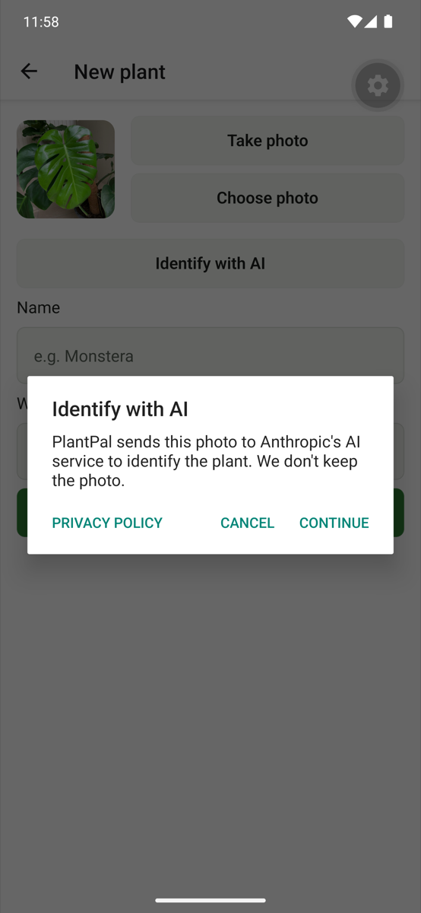 | 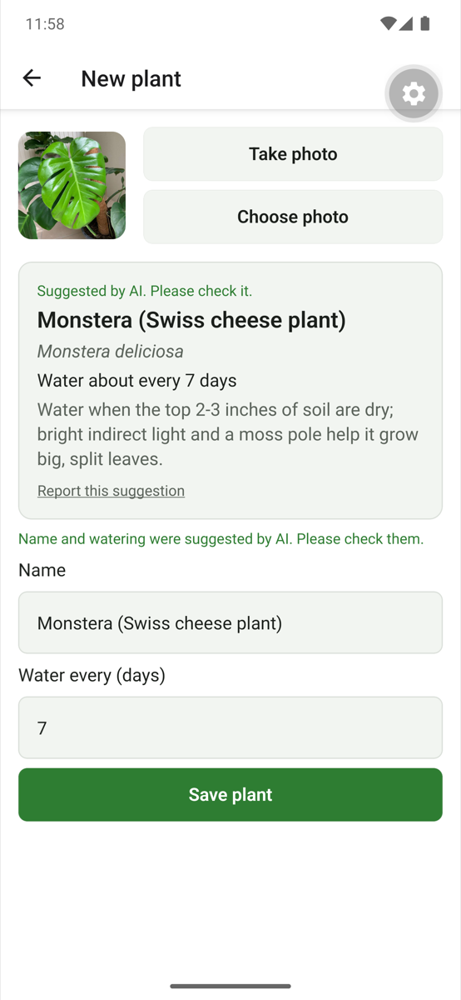 | 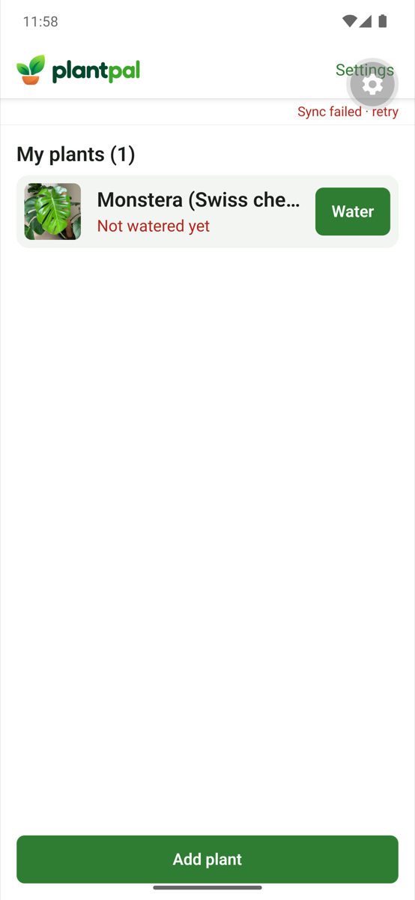 |

The identification took 2.8 s and cost $0.006. The plant then synced with its photo (checked in the
local database) after refreshing the local Blob credentials: "Sync failed" in the last screenshot
was the 12-hour local credential having expired, not this feature.

Notes from the run:
- The first two attempts failed before reaching the app's screens: Android's "isn't responding"
  dialog and a Maestro device-server timeout, with the Mac at a load average of 26. The same
  host-load flakiness as M6/M7; the third run passed once the load dropped.
- One local API call timed out at 15 s with no response (the first call after the dev server
  picked up the new route); the next calls took 2.5 s. Not reproduced since; to watch in
  production logs (`status: "timeout"`).

### Not proven yet
- On a physical phone and a store build (comes with build 7 in M9.4).
- The detail screen's "Use these details" path on the emulator (covered by code review and the
  form test only).
- "Report this suggestion" from the emulator (unit-tested in the app, integration-tested on the
  server).
- The offline state on a device (unit-tested).

## M9.3: Spanish (2026-10-20)

### What was built
| Piece | Where |
|---|---|
| i18next + react-i18next; every user-facing string in `en.json` / `es.json` (typed keys) | `apps/mobile/src/i18n/` |
| Device language by default (`expo-localization`), choice stored on the device (SQLite key-value store, survives sign-out), re-read when the app returns to the front | `apps/mobile/src/i18n/index.ts` |
| Language row in Settings (System default / English / Español); English \| Español switch on sign-in | `components/language-card.tsx`, `components/language-toggle.tsx` |
| Plurals (`_one`/`_other`, `Intl.PluralRules` polyfilled only where missing), dates via `Intl` in `en-US` / `es-419` | `src/i18n`, `intl-pluralrules` |
| Errors, alerts, paywall (both A/B variants), guide, notifications, accessibility labels | all screens and components |
| Local reminders in the app's language, rescheduled when it changes | `notifications/plan.ts`, `use-notifications.ts` |
| Server pushes in each phone's language: `devices.language` (migration 0005, default `en`), sent at registration and on language change; shared per-language push texts | `packages/shared/src/push-texts.ts`, `apps/api/src/push/reminders.ts` |
| Spanish web pages `/es/privacy`, `/es/support`, `/es/delete-account` (own root layout, `<html lang="es">`); the app links to the page in its language | `apps/api/src/app/(es)`, `apps/api/src/site/` |
| OS level: Android per-app language (`localeConfig`), iOS `CFBundleLocalizations` and Spanish permission texts (native: ships in build 7) | `apps/mobile/app.config.ts` |
| Spanish store listing (es-419) with checked lengths and a list of terms to review | `docs/release/store-listing.es.md` |

Library choice: i18next + react-i18next (plain JSON, no build step, the server can reuse texts,
switch without restart). Versions pinned at least two weeks old (i18next 26.4.2, react-i18next
17.0.15, eslint-plugin-i18next 6.1.5, intl-pluralrules 2.0.1). Docs used: Expo SDK 57
[expo-localization](https://docs.expo.dev/versions/v57.0.0/sdk/localization/) and
[Localization guide](https://docs.expo.dev/guides/localization/),
[expo-sqlite key-value store](https://docs.expo.dev/versions/v57.0.0/sdk/sqlite/), Next.js 16's
bundled docs (multiple root layouts), [i18next FAQ](https://www.i18next.com/how-to/faq) (plural
rules on runtimes without `Intl.PluralRules`).

### Guardrails
- **Parity test** (`__tests__/i18n-test.tsx`): both files have exactly the same keys, the same
  `{{variables}}` in every text, no empty texts, and every plural has both forms.
- **Lint**: `i18next/no-literal-string` on screens and components (JSX text and the `label`,
  `placeholder`, `title`, `accessibilityLabel`, `accessibilityHint` attributes) plus a rule against
  literal texts in `Alert.alert`. Proven with a probe file: an alert, a `<Text>` and a `label`
  with hard-coded English each fail lint.
- **Typed keys**: `t('a.typo')` doesn't compile.

### A bug found on the device, and why the tests missed it
On the emulator, switching to Español on the sign-in screen translated every text but left
**English highlighted**. Cause: the app runs the **React Compiler** (`experiments.reactCompiler`),
which memoizes values computed during render; the toggle read the language through a plain
function, so its first value was cached. The same pattern could leave plant statuses, dates and
the guide and paywall texts in the old language until their data changed. Jest didn't run the
compiler, so the unit test passed.

Fix: render-time helpers take `t` from `useT()` and dates take `useLanguage()` (reactive state),
so the language is a real dependency. **Jest now compiles with the React Compiler like the app**:
it reproduced the bug before the fix, and a guide test fails if a text is computed from the
non-reactive `t` (checked by temporarily reintroducing the bug).

### Tests
Whole repo: lint ✅, typecheck ✅, tests ✅ shared 2 · API 110 · mobile 136 = **248**.
New: parity and switching (`i18n-test.tsx`, 11), guide switching while on screen, push
re-registration on language change, Spanish server pushes (one user, an English phone and a
Spanish tablet), older app versions without a language keep the stored one.

Maestro (development build, emulator): **flow 5** adds a plant in English, switches to Español in
Settings, sees the list already on screen in Spanish ("Aún sin regar", "Mis plantas (1)"),
restarts the app (still Spanish), switches back: passed. Flow 4 (add a plant with AI) passed in
M9.2.

Also fixed on the way: a test-isolation gap in the API tests (push tickets weren't reset between
tests; the cron test flaked once depending on file order).

### Every screen in both languages
Captured with `e2e/tools/screens-tour.yaml` (development build, so the dev tools button shows at
the top right). The Spanish sign-in is from after the toggle fix.

| Screen | English | Español |
|---|---|---|
| Sign-in (with the English | Español switch) | 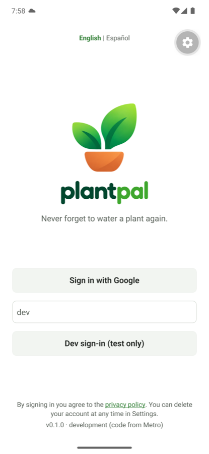 | 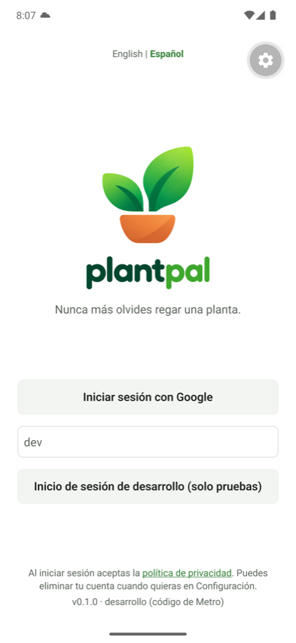 |
| Guide | 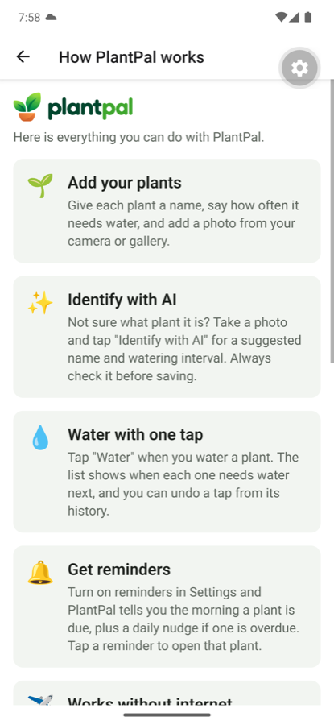 | 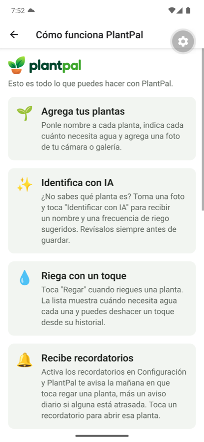 |
| Empty list | 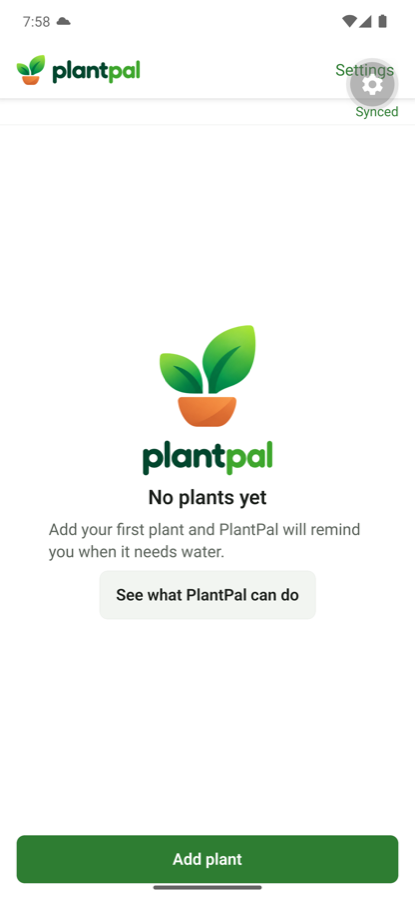 | 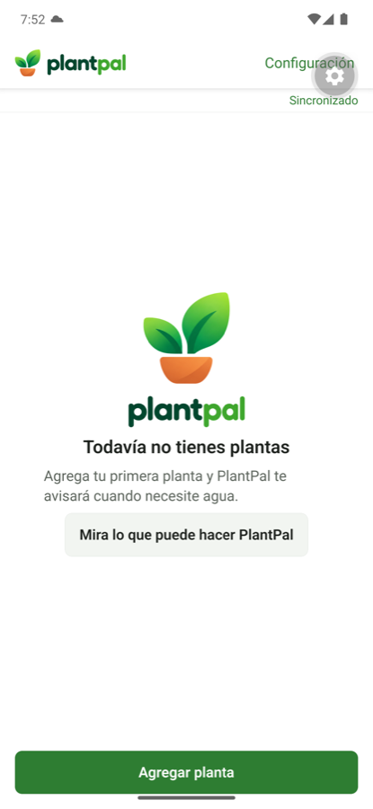 |
| AI first-use notice | 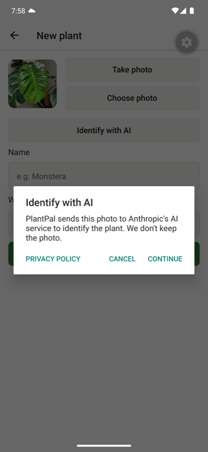 | 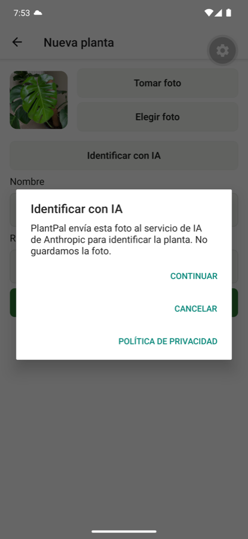 |
| AI suggestion, form pre-filled | 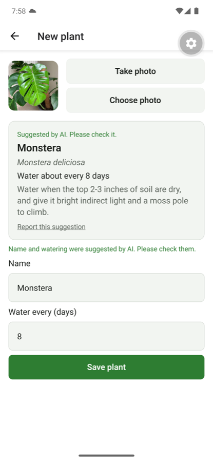 | 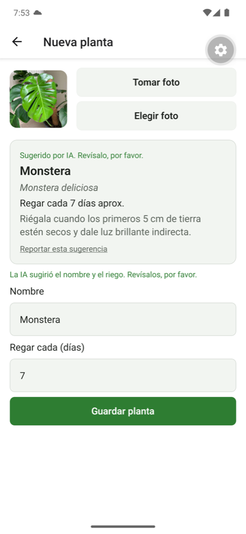 |
| Plant list | 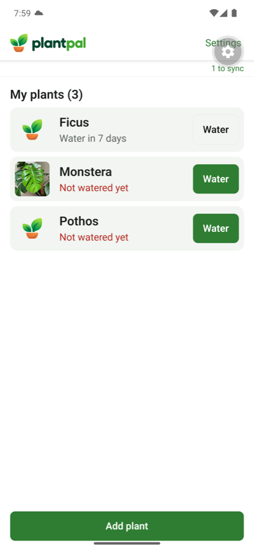 | 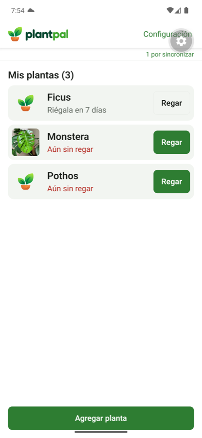 |
| Plant detail |  | 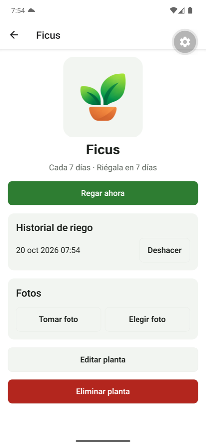 |
| Edit plant | 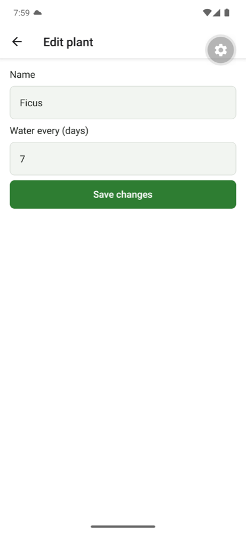 |  |
| Settings (Language row) | 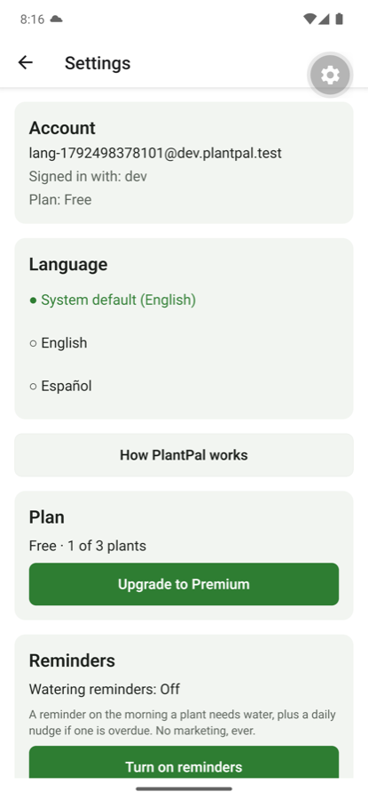 | 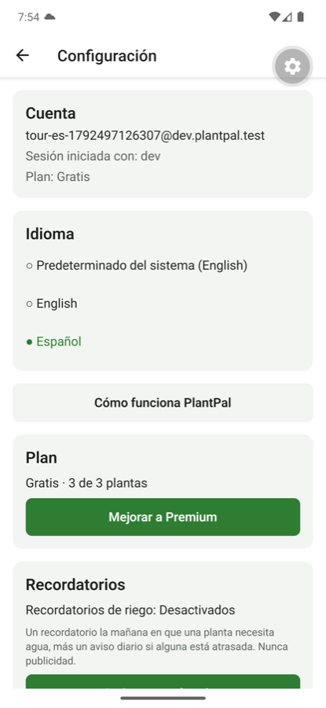 |
| Settings, bottom | 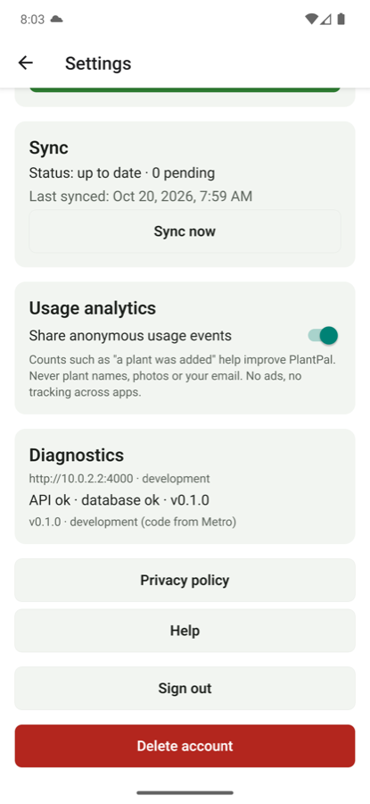 | 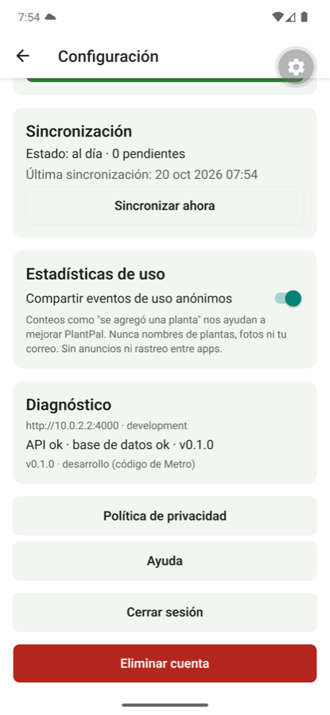 |
| Paywall |  | 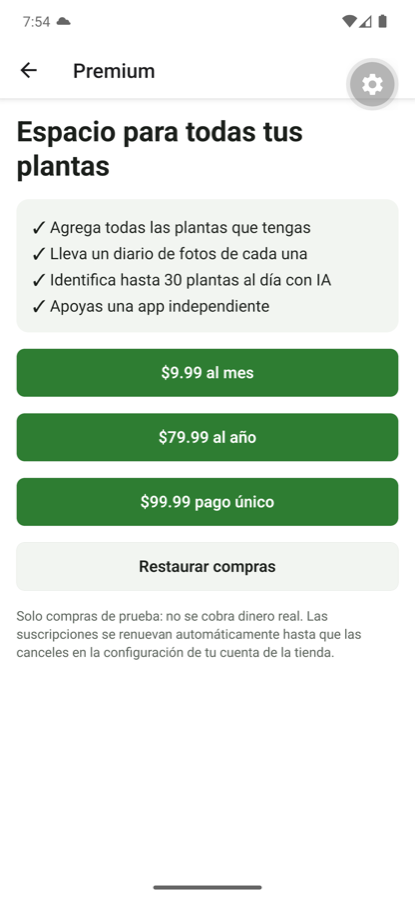 |

### Spanish style
Neutral Latin American Spanish with "tú". Terms I wasn't sure about are listed at the end of
[`store-listing.es.md`](../release/store-listing.es.md) for review (Configuración vs Ajustes,
"Atrasada" for plants named in the masculine, "No estoy seguro" and "Bienvenido" which are
gendered, Reportar vs Denunciar).

### Not proven yet
- Plural rules and Spanish dates on a **release** build (Hermes): the development build showed
  "Mis plantas (3)", "Cada 7 días" and "20 oct 2026", but whether the polyfill is active there
  wasn't checked.
- Android's per-app language setting and the Spanish iOS permission texts: native, need build 7.
- A Spanish server push received on a phone (unit- and integration-tested only).
- The Spanish web pages on Vercel (built and served locally; go live with the push).
- Review by a native speaker.

## M9.4: Release (2026-10-20)

| Step | Result |
|---|---|
| Push to `main` (`d8c6df0`) | CI ✅; Vercel production deployment Ready; build log `[migrate] migrations applied` (0004 AI tables, 0005 device language) |
| Production checks | `/api/health` ok (database ok); `/privacy`, `/es/privacy`, `/support`, `/es/support`, `/delete-account`, `/es/delete-account` all 200 with the right `<html lang>`; both privacy policies show the Anthropic section, dated October 20, 2026; `/api/plants/identify` and `/report` answer 401 without sign-in |
| Build 7 | EAS build `be10cf0b` (version code 7, runtime `3b6bf88f…`), auto-submitted to the internal track as a draft (submission `29ea01d1`). A second submission to the production track was refused by Play ("This version code was already uploaded"), which confirms the internal upload; the release was then created from the library in Play Console |
| Play Console (owner) | Data safety: App interactions now "App functionality, Analytics", optional, not shared. English listing: new full description and 4 screenshots. Spanish (Latin America) listing added: name "PlantPal: Riega tus plantas", descriptions, 4 screenshots. Production release 7 (0.1.0), full rollout, with English and Spanish release notes |
| Sent for review | All four changes together, 2026-10-20, managed publishing off (the release goes live once approved) |

Store screenshots: [`docs/release/screenshots/`](../release/screenshots/) (English) and
[`docs/release/screenshots/es/`](../release/screenshots/es/), made from seeded demo accounts with
Android's demo status bar (`docs/release/screenshots/README.md`).

### Not proven yet
- **Build 7 was not tested on a phone before it was sent for review** (the owner chose to send it
  for review right away). Identify with AI against production, Spanish on a release build (plural
  rules, dates), Android's per-app language setting and a Spanish push are verified only on the
  emulator, the local API, or in tests.
- Google's review result.
- A real identification against the production API (production has no test sign-in; the first
  one will come from the app).
